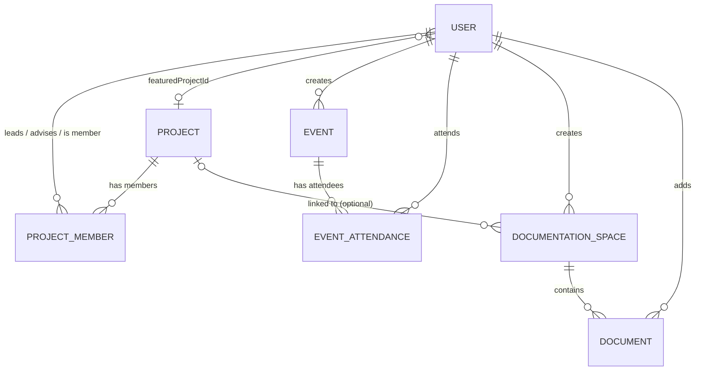

# Database Schema Documentation

This document describes the MongoDB (NoSQL) schema of the system: the collections, every attribute, the enum values, and the relationships between collections.

**Design notes**

1. MongoDB is used, so relationships are handled with `ObjectId` references instead of strict foreign keys. "FK" below means a reference to another collection's `_id`.
2. Project members (lead / advisor / member) are managed through `PROJECT_MEMBER`.
3. Events store multiple images in `imageUrl` (`String[]`) instead of a separate media entity.
4. Event attendance only tracks registration and status (no check-in time).
5. Activity logs have been removed as requested.

---

## 1. Entity Overview

| Collection | Purpose |
|---|---|
| `USER` | A member of the community (member directory profile) |
| `PROJECT` | A project run by members |
| `PROJECT_MEMBER` | Join collection linking users to projects with a role |
| `EVENT` | A meeting, workshop or competition |
| `EVENT_ATTENDANCE` | Join collection linking users to events they registered for |
| `DOCUMENTATION_SPACE` | A container of document links, optionally tied to a project |
| `DOCUMENT` | Metadata and external URL of a single document |

---

## 2. Collections and Attributes

### 2.1 USER

Updated to fit the features of the **Member Directory**.

| Attribute | Type | Key / Constraint | Description |
|---|---|---|---|
| `_id` | ObjectId | PK | Unique identifier of the user |
| `googleId` | String | Unique | Google account ID used for sign-in |
| `email` | String | | User email |
| `name` | String | | Full name |
| `photoUrl` | String | | Profile photo URL |
| `positions` | String[] | | Positions held by the user |
| `year` | String | | Year of study |
| `course` | String | | Course / programme |
| `origin` | Object | | Where the user is from |
| `origin.state` | String | | State |
| `origin.country` | String | | Country |
| `description` | String | | Short bio |
| `linkedinUrl` | String | | LinkedIn profile URL |
| `githubUrl` | String | | GitHub profile URL |
| `instagramUrl` | String | | Instagram profile URL |
| `featuredProjectId` | ObjectId | FK → `PROJECT._id` (optional) | Project the user chooses to feature on their profile |
| `createdAt` | Date | | Creation timestamp |
| `updatedAt` | Date | | Last update timestamp |
| `isActive` | Boolean | | Whether the user account is active |

### 2.2 PROJECT

| Attribute | Type | Key / Constraint | Description |
|---|---|---|---|
| `_id` | ObjectId | PK | Unique identifier of the project |
| `title` | String | | Project title |
| `description` | String | | Project description |
| `category` | String | | Project category |
| `technologies` | String[] | | Technologies used |
| `status` | String | Enum | Project status (see [Enum Values](#4-enum-values)) |
| `createdAt` | Date | | Project creation date |
| `updatedAt` | Date | | Project setting update date |

Project people are not stored on this collection. They are stored in `PROJECT_MEMBER`:

| Role | Description |
|---|---|
| `lead` | Project leader. Granted more control over project board configuration |
| `advisor` | Advisor of the project |
| `member` | Project member |

### 2.3 PROJECT_MEMBER

Defines the relationship between `USER` and `PROJECT`. A user can be the lead of a project, an advisor of a project, or a member of a project.

| Attribute | Type | Key / Constraint | Description |
|---|---|---|---|
| `_id` | ObjectId | PK | Unique identifier |
| `projectId` | ObjectId | FK → `PROJECT._id` | The project |
| `userId` | ObjectId | FK → `USER._id` | The user |
| `role` | String | Enum | `lead` / `advisor` / `member` |
| `joinedAt` | Date | | When the user joined the project |

### 2.4 EVENT

| Attribute | Type | Key / Constraint | Description |
|---|---|---|---|
| `_id` | ObjectId | PK | Unique identifier of the event |
| `title` | String | | Event title |
| `description` | String | | Event description |
| `category` | Enum | | `meeting` / `workshop` / `competition` |
| `highlight` | Boolean | | Whether the event is highlighted/featured |
| `startAt` | Date | | Start date and time |
| `endAt` | Date | | End date and time |
| `venue` | String | | Location of the event |
| `imageUrl` | String[] | | Multiple image URLs for the event |
| `capacity` | Number | Optional | Maximum number of attendees |
| `status` | String | Enum | `draft` / `published` / `cancelled` / `completed` |
| `createdBy` | ObjectId | FK → `USER._id` | User who created the event |
| `updatedBy` | ObjectId | FK → `USER._id` | User who last updated the event |
| `createdAt` | Date | | Creation timestamp |
| `updatedAt` | Date | | Last update timestamp |

### 2.5 EVENT_ATTENDANCE

Tracks registration and status only (no check-in time).

| Attribute | Type | Key / Constraint | Description |
|---|---|---|---|
| `_id` | ObjectId | PK | Unique identifier |
| `eventId` | ObjectId | FK → `EVENT._id` | The event |
| `userId` | ObjectId | FK → `USER._id` | The attending user |
| `status` | String | Enum | `registered` / `attended` / `cancelled` / `no_show` |
| `registeredAt` | Date | | When the user registered |

### 2.6 DOCUMENTATION_SPACE

A documentation space contains one or more `DOCUMENT` entries.

| Attribute | Type | Key / Constraint | Description |
|---|---|---|---|
| `_id` | ObjectId | PK | Unique identifier |
| `title` | String | | Title of the documentation space, which is the project name (e.g. *Airost Intranet*) |
| `description` | String | | Description of the project |
| `projectId` | ObjectId | FK → `PROJECT._id` (optional) | Project this space is linked to |
| `createdBy` | ObjectId | FK → `USER._id` | User who created the space |
| `accessType` | String | Enum | Who is allowed to access: `public` / `members` / `selected` |
| `updateType` | String | Enum | Who is allowed to add, edit, or archive documents: `admins_only` / `project_members` / `selected` |
| `createdAt` | Date | | Date and time the space was created |
| `updatedAt` | Date | | Date and time the space was last modified |

### 2.7 DOCUMENT

`DOCUMENT` does **not** store the actual document content. It only stores the metadata and external URL needed to organize and access the document.

| Attribute | Type | Key / Constraint | Description |
|---|---|---|---|
| `_id` | ObjectId | PK | Unique identifier |
| `spaceId` | ObjectId | FK → `DOCUMENTATION_SPACE._id` | The documentation space containing this document |
| `title` | String | | Title of the document link (e.g. *Database Schema*) |
| `url` | String | | External URL, such as a Google Docs or Google Drive link |
| `provider` | String | Enum | Platform where the document is hosted: `google_drive` / `google_doc` / `external_url` / `other` |
| `area` | String | Enum | Category of the document: `general` / `meeting` / `technical` / `resource` / `other` |
| `createdBy` | ObjectId | FK → `USER._id` | User who added the document |
| `archived` | Boolean | Default `false` | Whether the document link has been archived |
| `createdAt` | Date | | When the document link was added |
| `updatedAt` | Date | | When the document information was last modified |

---

## 3. Relationships

| # | From | To | Cardinality | Reference field | Description |
|---|---|---|---|---|---|
| 1 | `USER` | `PROJECT` | Many-to-many (0..* : 0..*) | via `PROJECT_MEMBER` | A user leads / advises / is a member of many projects; a project has many users |
| 2 | `USER` | `PROJECT_MEMBER` | One-to-many | `PROJECT_MEMBER.userId` | One user has many project memberships |
| 3 | `PROJECT` | `PROJECT_MEMBER` | One-to-many | `PROJECT_MEMBER.projectId` | One project has many members |
| 4 | `USER` | `PROJECT` | Many-to-one (optional) | `USER.featuredProjectId` | A user may feature one project on their profile |
| 5 | `USER` | `EVENT` | One-to-many (1 : 0..*) | `EVENT.createdBy`, `EVENT.updatedBy` | A user creates (and updates) many events |
| 6 | `EVENT` | `EVENT_ATTENDANCE` | One-to-many (1 : 0..*) | `EVENT_ATTENDANCE.eventId` | An event has many attendance records ("has attendees") |
| 7 | `USER` | `EVENT_ATTENDANCE` | One-to-many (1 : 0..*) | `EVENT_ATTENDANCE.userId` | A user "attends" many events through attendance records |
| 8 | `USER` | `EVENT` | Many-to-many | via `EVENT_ATTENDANCE` | Users register for events; events have many users |
| 9 | `USER` | `DOCUMENTATION_SPACE` | One-to-many (1 : 0..*) | `DOCUMENTATION_SPACE.createdBy` | A user creates many documentation spaces |
| 10 | `PROJECT` | `DOCUMENTATION_SPACE` | One-to-many (optional) | `DOCUMENTATION_SPACE.projectId` | A space can be linked to a project; a space may have no project |
| 11 | `DOCUMENTATION_SPACE` | `DOCUMENT` | One-to-many (1 : 0..*) | `DOCUMENT.spaceId` | A space contains many documents |
| 12 | `USER` | `DOCUMENT` | One-to-many | `DOCUMENT.createdBy` | A user adds many documents |

### Relationship diagram

---

## 4. Enum Values

| Field | Allowed values |
|---|---|
| `PROJECT.status` | `planning`, `active`, `completed`, `archived` |
| `PROJECT_MEMBER.role` | `lead`, `advisor`, `member` |
| `EVENT.category` | `meeting`, `workshop`, `competition` |
| `EVENT.status` | `draft`, `published`, `cancelled`, `completed` |
| `EVENT_ATTENDANCE.status` | `registered`, `attended`, `cancelled`, `no_show` |
| `DOCUMENTATION_SPACE.accessType` | `public`, `members`, `selected` |
| `DOCUMENTATION_SPACE.updateType` | `admins_only`, `project_members`, `selected` |
| `DOCUMENT.provider` | `google_drive`, `google_doc`, `external_url`, `other` |
| `DOCUMENT.area` | `general`, `meeting`, `technical`, `resource`, `other` |

---

## 5. Discrepancies Between the Diagram and the Text Descriptions

The ER diagram and the written tables in the source file do not fully agree. This document follows the **ER diagram** as the primary source. Please confirm which is current:

| Topic | ER diagram | Written description |
|---|---|---|
| Documents in a space | Separate `DOCUMENT` collection, linked by `DOCUMENT.spaceId` | `documents` is an embedded array inside the documentation space |
| Space access | Single field `accessType` (`public` / `members` / `selected`) | `access.type` (All / Project members / Selected members) plus `access.members` list |
| Space update permission | Single field `updateType` (`admins_only` / `project_members` / `selected`) | `update.type` (All / Project members / Selected members) plus `update.members` list |
| Selected-user lists | No field to store the selected users | `access.members` and `update.members` store User IDs |
| `DOCUMENT.area` | `general`, `meeting`, `technical`, `resource`, `other` | General, Requirements, Design, Development, Testing, Deployment |
| `DOCUMENT.provider` | `google_drive`, `google_doc`, `external_url`, `other` | Google Docs, Google Drive, Other |
| `PROJECT` fields | `title`, `description`, `category`, `technologies`, `status`, timestamps; people via `PROJECT_MEMBER` | Table lists `lead`, `members`, `createdAt`, `updatedAt` as if stored on the project |
| `DOCUMENT.createdBy` | Marked as FK | Described as User ID from `USER` |

If the `selected` option is meant to be used for access or update permissions, the schema needs a place to store those user IDs (for example, `accessMembers` / `updateMembers` arrays on `DOCUMENTATION_SPACE`, or a separate join collection).
