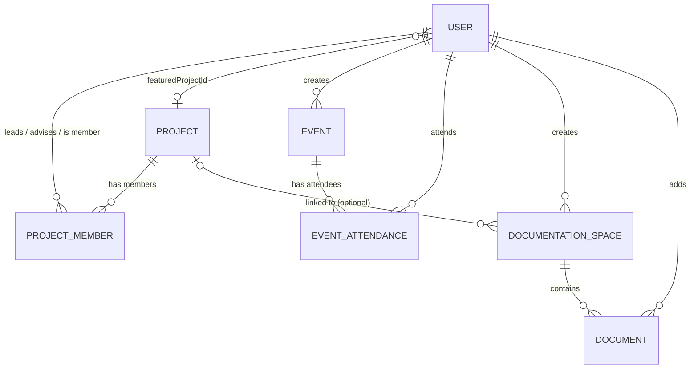

# Database schema documentation

This document describes the MongoDB schema of the system: collections, attributes, enum values, and relationships.

Design notes:
1. Relationships use `ObjectId` references instead of foreign keys. The label "FK" below indicates a reference to another collection's `_id`.
2. Project members (lead, advisor, member) are managed through `PROJECT_MEMBER`.
3. Events store multiple images in `imageUrl` (`String[]`) instead of a separate media entity.
4. Event attendance tracks registration and status only.
5. Activity logs have been removed.

---

## 1. Entity overview

| Collection | Purpose |
|---|---|
| `USER` | Community member profile in the member directory |
| `PROJECT` | Project run by members |
| `PROJECT_MEMBER` | Join collection linking users to projects with a role |
| `EVENT` | Meeting, workshop, or competition |
| `EVENT_ATTENDANCE` | Join collection linking users to events they registered for |
| `DOCUMENTATION_SPACE` | Container of document links, optionally tied to a project |
| `DOCUMENT` | Metadata and external URL for a single document |

---

## 2. Collections and attributes

### 2.1 USER

Member Directory profile schema:

| Attribute | Type | Key / Constraint | Description |
|---|---|---|---|
| `_id` | ObjectId | PK | Unique identifier of the user |
| `googleId` | String | Unique | Google account ID used for sign-in |
| `email` | String | | User email |
| `name` | String | | Full name |
| `photoUrl` | String | | Profile photo URL |
| `positions` | String[] | | Positions held by the user |
| `year` | String | | Year of study |
| `course` | String | | Course or programme |
| `origin` | Object | | Geographic origin |
| `origin.state` | String | | State |
| `origin.country` | String | | Country |
| `description` | String | | Short bio |
| `linkedinUrl` | String | | LinkedIn profile URL |
| `githubUrl` | String | | GitHub profile URL |
| `instagramUrl` | String | | Instagram profile URL |
| `featuredProjectId` | ObjectId | FK -> `PROJECT._id` (optional) | Featured project displayed on profile |
| `createdAt` | Date | | Creation timestamp |
| `updatedAt` | Date | | Last update timestamp |
| `isActive` | Boolean | | Whether the user account is active |

### 2.2 PROJECT

| Attribute | Type | Key / Constraint | Description |
|---|---|---|---|
| `_id` | ObjectId | PK | Unique identifier of the project |
| `title` | String | | Project title |
| `description` | String | | Project description |
| `category` | String | | Project category |
| `technologies` | String[] | | Technologies used |
| `status` | String | Enum | Project status (see [Enum values](#4-enum-values)) |
| `createdAt` | Date | | Project creation date |
| `updatedAt` | Date | | Project update date |

Project memberships are stored in `PROJECT_MEMBER`, not on the `PROJECT` record directly:

| Role | Description |
|---|---|
| `lead` | Project leader with board configuration permissions |
| `advisor` | Advisor to the project |
| `member` | Project member |

### 2.3 PROJECT_MEMBER

Links a `USER` to a `PROJECT` with an assigned role.

| Attribute | Type | Key / Constraint | Description |
|---|---|---|---|
| `_id` | ObjectId | PK | Unique identifier |
| `projectId` | ObjectId | FK -> `PROJECT._id` | The project |
| `userId` | ObjectId | FK -> `USER._id` | The user |
| `role` | String | Enum | `lead`, `advisor`, or `member` |
| `joinedAt` | Date | | Date joined |

### 2.4 EVENT

| Attribute | Type | Key / Constraint | Description |
|---|---|---|---|
| `_id` | ObjectId | PK | Unique identifier of the event |
| `title` | String | | Event title |
| `description` | String | | Event description |
| `category` | Enum | | `meeting`, `workshop`, or `competition` |
| `highlight` | Boolean | | Whether the event is featured |
| `startAt` | Date | | Start date and time |
| `endAt` | Date | | End date and time |
| `venue` | String | | Location of the event |
| `imageUrl` | String[] | | Image URLs for the event |
| `capacity` | Number | Optional | Maximum attendees |
| `status` | String | Enum | `draft`, `published`, `cancelled`, or `completed` |
| `createdBy` | ObjectId | FK -> `USER._id` | User who created the event |
| `updatedBy` | ObjectId | FK -> `USER._id` | User who last updated the event |
| `createdAt` | Date | | Creation timestamp |
| `updatedAt` | Date | | Last update timestamp |

### 2.5 EVENT_ATTENDANCE

Tracks registration and attendance status.

| Attribute | Type | Key / Constraint | Description |
|---|---|---|---|
| `_id` | ObjectId | PK | Unique identifier |
| `eventId` | ObjectId | FK -> `EVENT._id` | The event |
| `userId` | ObjectId | FK -> `USER._id` | The attending user |
| `status` | String | Enum | `registered`, `attended`, `cancelled`, or `no_show` |
| `registeredAt` | Date | | Registration timestamp |

### 2.6 DOCUMENTATION_SPACE

A documentation space contains document link records.

| Attribute | Type | Key / Constraint | Description |
|---|---|---|---|
| `_id` | ObjectId | PK | Unique identifier |
| `title` | String | | Title of the documentation space |
| `description` | String | | Space description |
| `projectId` | ObjectId | FK -> `PROJECT._id` (optional) | Project linked to this space |
| `createdBy` | ObjectId | FK -> `USER._id` | User who created the space |
| `accessType` | String | Enum | Who can access: `public`, `members`, or `selected` |
| `updateType` | String | Enum | Who can manage documents: `admins_only`, `project_members`, or `selected` |
| `createdAt` | Date | | Creation timestamp |
| `updatedAt` | Date | | Last modified timestamp |

### 2.7 DOCUMENT

`DOCUMENT` stores metadata and external URLs to organize and access documents. It does not store document content.

| Attribute | Type | Key / Constraint | Description |
|---|---|---|---|
| `_id` | ObjectId | PK | Unique identifier |
| `spaceId` | ObjectId | FK -> `DOCUMENTATION_SPACE._id` | Documentation space containing this document |
| `title` | String | | Title of the document link |
| `url` | String | | External URL (Google Docs, Google Drive, or HTTPS link) |
| `provider` | String | Enum | Platform: `google_drive`, `google_doc`, `external_url`, or `other` |
| `area` | String | Enum | Category: `general`, `meeting`, `technical`, `resource`, or `other` |
| `createdBy` | ObjectId | FK -> `USER._id` | User who added the document |
| `archived` | Boolean | Default `false` | Whether the document link is archived |
| `createdAt` | Date | | Creation timestamp |
| `updatedAt` | Date | | Last modified timestamp |

---

## 3. Relationships

| # | From | To | Cardinality | Reference field | Description |
|---|---|---|---|---|---|
| 1 | `USER` | `PROJECT` | Many-to-many (0..* : 0..*) | via `PROJECT_MEMBER` | A user leads, advises, or joins many projects; a project has many users |
| 2 | `USER` | `PROJECT_MEMBER` | One-to-many | `PROJECT_MEMBER.userId` | One user has many project memberships |
| 3 | `PROJECT` | `PROJECT_MEMBER` | One-to-many | `PROJECT_MEMBER.projectId` | One project has many members |
| 4 | `USER` | `PROJECT` | Many-to-one (optional) | `USER.featuredProjectId` | A user may feature one project on their profile |
| 5 | `USER` | `EVENT` | One-to-many (1 : 0..*) | `EVENT.createdBy`, `EVENT.updatedBy` | A user creates and updates events |
| 6 | `EVENT` | `EVENT_ATTENDANCE` | One-to-many (1 : 0..*) | `EVENT_ATTENDANCE.eventId` | An event has many attendance records |
| 7 | `USER` | `EVENT_ATTENDANCE` | One-to-many (1 : 0..*) | `EVENT_ATTENDANCE.userId` | A user attends events through attendance records |
| 8 | `USER` | `EVENT` | Many-to-many | via `EVENT_ATTENDANCE` | Users register for events; events have many registered users |
| 9 | `USER` | `DOCUMENTATION_SPACE` | One-to-many (1 : 0..*) | `DOCUMENTATION_SPACE.createdBy` | A user creates documentation spaces |
| 10 | `PROJECT` | `DOCUMENTATION_SPACE` | One-to-many (optional) | `DOCUMENTATION_SPACE.projectId` | A space can link to a project or remain standalone |
| 11 | `DOCUMENTATION_SPACE` | `DOCUMENT` | One-to-many (1 : 0..*) | `DOCUMENT.spaceId` | A space contains many documents |
| 12 | `USER` | `DOCUMENT` | One-to-many | `DOCUMENT.createdBy` | A user adds documents |

### Relationship diagram

---

## 4. Enum values

| Field | Allowed values |
|---|---|
| `PROJECT.status` | `planning`, `active`, `completed`, `archived` |
| `PROJECT_MEMBER.role` | `lead`, `advisor`, `member` |
| `EVENT.category` | `meeting`, `workshop`, `competition` |
| `EVENT.status` | `draft`, `published`, `cancelled`, `completed` |
| `EVENT_ATTENDANCE.status` | `registered`, `attended`, `cancelled`, `no_show` |
| `DOCUMENTATION_SPACE.accessType` | `public`, `members`, `selected` |
| `DOCUMENTATION_SPACE.updateType` | `admins_only`, `project_members`, `selected` |
| `DOCUMENT.provider` | `google_drive`, `google_doc`, `external_url`, `other` |
| `DOCUMENT.area` | `general`, `meeting`, `technical`, `resource`, `other` |

---

## 5. Discrepancies between the diagram and text descriptions

The ER diagram and written tables in the source file do not fully agree. This document treats the ER diagram as the primary source:

| Topic | ER diagram | Written description |
|---|---|---|
| Documents in a space | Separate `DOCUMENT` collection, linked by `DOCUMENT.spaceId` | `documents` is an embedded array inside the documentation space |
| Space access | Single field `accessType` (`public` / `members` / `selected`) | `access.type` (All / Project members / Selected members) plus `access.members` list |
| Space update permission | Single field `updateType` (`admins_only` / `project_members` / `selected`) | `update.type` (All / Project members / Selected members) plus `update.members` list |
| Selected-user lists | No field to store the selected users | `access.members` and `update.members` store User IDs |
| `DOCUMENT.area` | `general`, `meeting`, `technical`, `resource`, `other` | General, Requirements, Design, Development, Testing, Deployment |
| `DOCUMENT.provider` | `google_drive`, `google_doc`, `external_url`, `other` | Google Docs, Google Drive, Other |
| `PROJECT` fields | `title`, `description`, `category`, `technologies`, `status`, timestamps; people via `PROJECT_MEMBER` | Table lists `lead`, `members`, `createdAt`, `updatedAt` as if stored on the project |
| `DOCUMENT.createdBy` | Marked as FK | Described as User ID from `USER` |

When using the `selected` option for access or update permissions, the schema stores selected user IDs in `accessMembers` and `updateMembers` arrays on `DOCUMENTATION_SPACE`.
