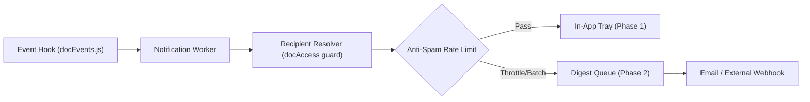

# Design Proposal: Documentation Notifications System

**Status:** Proposed  
**Author:** AI Pair Programmer (Documentation Feature Team)  
**Target:** Airost Intranet Core Team (Lee, Tony, Ahmad, Zi Ping)  
**Related Documents:** [`docs/api/documentation.md`](file:///c:/Users/ganru/Documents/airost-intranet/docs/api/documentation.md), [`docs/architecture/documentation-data-layer.md`](file:///c:/Users/ganru/Documents/airost-intranet/docs/architecture/documentation-data-layer.md), [`features.md`](file:///c:/Users/ganru/Documents/airost-intranet/features.md), [`server/utils/docEvents.js`](file:///c:/Users/ganru/Documents/airost-intranet/server/utils/docEvents.js)

---

## 1. Executive Summary & System Boundary

### 1.1 What Exists Today
The Documentation feature already incorporates a decoupled, robust internal event hook system implemented in [`server/utils/docEvents.js`](file:///c:/Users/ganru/Documents/airost-intranet/server/utils/docEvents.js):
- **EventEmitter Architecture**: Exposes `emitDocEvent(type, payload)` and `onDocEvent(type, listener)` (with `on` alias).
- **Post-Commit Guarantee**: Events are strictly emitted **after** successful database writes within the isolated service layer [`server/services/docService.js`](file:///c:/Users/ganru/Documents/airost-intranet/server/services/docService.js). Failed writes or validation errors never emit events.
- **Resilient Execution**: Listeners run in isolated `try/catch` wrappers. Throwing or slow listeners cannot crash, revert, or interrupt the caller's HTTP response.
- **Standardized Payload**: All event types emit lightweight, metadata-safe scalar payloads:
  ```javascript
  {
    actorId: string,      // User ID who performed the mutation
    spaceId: string,      // ID of the target Documentation Space
    projectId: string|null, // ID of linked project (or null for standalone spaces)
    documentId?: string,  // ID of the target document (for document-level events)
    title: string         // Space title or Document title
  }
  ```
- **Active Event Types Emitted**:
  1. `space.created`
  2. `space.updated`
  3. `space.deleted` (admin permanent cascade)
  4. `space.owner_reassigned` (admin oversight transfer)
  5. `document.created`
  6. `document.updated`
  7. `document.archived` (soft delete)
  8. `document.restored` (un-archive)
  9. `document.deleted` (admin permanent hard delete)

### 1.2 What Is Missing
Inspection of the codebase confirms that **no notification infrastructure exists**:
- No notification models (`Notification.js`, `NotificationRecipient.js`) exist in `server/models/`.
- No notification routes, controllers, or dispatchers exist in `server/`.
- No client-side notification bell, unread badge counter, popover drawer, or notification settings context exist in `client/src/`.
- Current occurrences of the word "notification" in the codebase are limited to ephemeral UI toast alerts (DaisyUI/Ant Design toasts in [`SpaceListScreen.js`](file:///c:/Users/ganru/Documents/airost-intranet/client/src/pages/Documentation/components/SpaceListScreen.js) and task drag feedback in [`BurnBarrel.js`](file:///c:/Users/ganru/Documents/airost-intranet/client/src/pages/ProjectTracking/components/BurnBarrel.js)).

### 1.3 System Boundary & Responsibility
Building a generic Notification Center and Delivery Engine is an independent, cross-cutting feature owned by the platform's **Notifications** roadmap work (classified as priority 🟠 **High** in [`features.md`](file:///c:/Users/ganru/Documents/airost-intranet/features.md#L267-L280), Phase 5).

> [!IMPORTANT]
> **Boundary Statement:** Documentation is an event *producer*, not a notification *consumer* or *delivery engine*. Documentation must never establish bespoke notification tables, routes, or bells isolated from the rest of the intranet. Instead, the Documentation feature exposes standardized event triggers (`docEvents.js`), audience resolution criteria, and copy descriptors for consumption by the centralized Notifications service.

---

## 2. Event Eligibility & Recipient Resolution Rules

### 2.1 Core Recipient Invariants
1. **The Stealth / Authorization Parity Rule (Crucial)**:
   A user who cannot view a documentation space according to the authorization matrix must **never** receive a notification regarding that space or its documents. Leaking titles or mutation events to unauthorized users violates the 404 Stealth Rule (Locked Decision 3: unauthorized users get 404, never 403 or title leakage). Recipient resolution must reuse [`server/utils/docAccess.js:canViewSpace`](file:///c:/Users/ganru/Documents/airost-intranet/server/utils/docAccess.js#L26-L50).
2. **The Actor Exclusion Rule**:
   The `actorId` who initiated the mutation is unconditionally excluded from recipient lists (`recipientId !== actorId`). Users must never be notified of their own actions.
3. **Active Users Only**:
   Only verified, active intranet users receive notifications. Suspended or unverified accounts are filtered out during fan-out.

### 2.2 Space Type Audience Mapping
| Space `accessType` | Project Linkage | Target Audience |
| :--- | :--- | :--- |
| `all` | Standalone (`projectId: null`) | All active club members (subject to user opt-in preferences to prevent org-wide spam). |
| `all` | Project-linked (`projectId: ID`) | All active members of the associated project (via `PROJECT_MEMBER` / project lead resolution), plus any active member who has bookmarked/starred the space. |
| `project_members` | Project-linked (`projectId: ID`) | Exclusively members and leads of the linked project. Non-members are strictly excluded. |
| `selected` | Either | Exclusively users present in the space's `accessMembers[]` or `updateMembers[]` lists. |

### 2.3 Event Eligibility Matrix
Not all internal lifecycle events warrant an in-app notification. The table below outlines which events generate user-facing notifications:

| Event Type | User Notification? | Target Audience | Rationale |
| :--- | :---: | :--- | :--- |
| `document.created` | **Yes** | Space audience (excluding actor) | High value. Alerts collaborators that new documentation is available for review. |
| `document.updated` | **Yes (Throttled)** | Space audience (excluding actor) | High value when content/link updates, but requires 10-minute debouncing to prevent spam during rapid edits. |
| `document.archived` | **Yes** | Space audience (excluding actor) | Important lifecycle change. Informs members that a reference doc has been deprecated or removed from active view. |
| `document.restored` | **Yes** | Space audience (excluding actor) | Informs members that a previously archived document is active again. |
| `space.owner_reassigned` | **Yes** | Previous owner, new owner, and project leads | Administrative change. Both the assigned new owner and previous owner require direct notification. |
| `space.created` | **Conditional** | Project members (if project-linked) | Informs project team that a dedicated documentation hub was established. Standalone `all` spaces do not notify entire club by default. |
| `space.updated` | **No** | None | Low value. Routine title/description corrections create notification fatigue. |
| `space.deleted` | **No / Admin Only** | Space owner & Project Lead | Destructive cascade. Space no longer exists; in-app link would 404 immediately. |
| `document.deleted` | **No** | None | Admin-only permanent hard delete. Used for cleanup; zero user-facing value. |

---

## 3. Notification Payloads & In-App Copy

### 3.1 Standardized Notification Dispatch DTO
When the notification worker processes an eligible documentation event, it constructs the following payload for the central notification repository:

```typescript
interface DocumentationNotificationPayload {
  category: 'documentation';
  eventType: 'document.created' | 'document.updated' | 'document.archived' | 'document.restored' | 'space.owner_reassigned';
  actor: {
    id: string;
    name: string;
    photo?: string;
  };
  resource: {
    spaceId: string;
    spaceTitle: string;
    documentId?: string;
    documentTitle?: string;
    projectId?: string | null;
    projectTitle?: string | null;
  };
  actionUrl: string; // Target URI within the client SPA
  createdAt: string; // ISO-8601 timestamp
}
```

### 3.2 In-App Copy & Deep Link Specifications

| Event | In-App Copy Template | Deep Link (`actionUrl`) |
| :--- | :--- | :--- |
| `document.created` | **{actor.name}** added document **"{document.title}"** in **{space.title}** | `/documentation?spaceId={space.id}&docId={document.id}` |
| `document.updated` | **{actor.name}** updated document **"{document.title}"** in **{space.title}** | `/documentation?spaceId={space.id}&docId={document.id}` |
| `document.archived` | **{actor.name}** archived document **"{document.title}"** from **{space.title}** | `/documentation?spaceId={space.id}&archived=true` |
| `document.restored` | **{actor.name}** restored document **"{document.title}"** in **{space.title}** | `/documentation?spaceId={space.id}&docId={document.id}` |
| `space.owner_reassigned` (To New Owner) | You were assigned as owner of documentation space **"{space.title}"** by **{actor.name}** | `/documentation?spaceId={space.id}` |
| `space.owner_reassigned` (To Stakeholders) | Ownership of **"{space.title}"** was transferred to **{newOwner.name}** | `/documentation?spaceId={space.id}` |

---

## 4. Dual-Database Data Model Sketch

To maintain compatibility with current **MongoDB/Mongoose** development and guarantee a frictionless migration to **Supabase (PostgreSQL + RLS)** in Phase 1 & Phase 5, the data model utilizes a decoupled **Fan-Out on Write** architecture separating the notification event from user recipient delivery status.

### 4.1 Relational PostgreSQL / Supabase Schema (Target Stack)

```sql
-- 1. Notification Event Table (Immutable record of what happened)
CREATE TABLE notifications (
    id UUID PRIMARY KEY DEFAULT gen_random_uuid(),
    actor_id UUID NOT NULL REFERENCES auth.users(id) ON DELETE CASCADE,
    category VARCHAR(30) NOT NULL DEFAULT 'documentation',
    event_type VARCHAR(50) NOT NULL,
    entity_type VARCHAR(30) NOT NULL, -- 'space' or 'document'
    entity_id UUID NOT NULL,
    space_id UUID REFERENCES documentation_spaces(id) ON DELETE CASCADE,
    project_id UUID REFERENCES projects(id) ON DELETE SET NULL,
    title VARCHAR(150) NOT NULL,
    body TEXT NOT NULL,
    action_url VARCHAR(255) NOT NULL,
    metadata JSONB DEFAULT '{}'::jsonb,
    created_at TIMESTAMPTZ NOT NULL DEFAULT timezone('utc'::text, now())
);

-- 2. Notification Recipients Table (Per-user delivery & read tracking)
CREATE TABLE notification_recipients (
    id UUID PRIMARY KEY DEFAULT gen_random_uuid(),
    notification_id UUID NOT NULL REFERENCES notifications(id) ON DELETE CASCADE,
    recipient_id UUID NOT NULL REFERENCES auth.users(id) ON DELETE CASCADE,
    is_read BOOLEAN NOT NULL DEFAULT false,
    read_at TIMESTAMPTZ,
    is_dismissed BOOLEAN NOT NULL DEFAULT false,
    created_at TIMESTAMPTZ NOT NULL DEFAULT timezone('utc'::text, now()),
    CONSTRAINT uq_recipient_notification UNIQUE (notification_id, recipient_id)
);

-- Compound Index for lightning-fast notification tray queries
CREATE INDEX idx_recipient_unread 
ON notification_recipients (recipient_id, is_read, created_at DESC) 
WHERE is_dismissed = false;

-- Supabase Row Level Security (RLS)
ALTER TABLE notification_recipients ENABLE ROW LEVEL SECURITY;

CREATE POLICY "Users can only view their own notifications"
ON notification_recipients FOR SELECT
USING (auth.uid() = recipient_id);

CREATE POLICY "Users can update read status of their own notifications"
ON notification_recipients FOR UPDATE
USING (auth.uid() = recipient_id)
WITH CHECK (auth.uid() = recipient_id);
```

### 4.2 Mongoose Schema Equivalent (Legacy / Current Stack)

```javascript
// server/models/Notification.js
const NotificationSchema = new mongoose.Schema({
  actorId: { type: mongoose.Schema.Types.ObjectId, ref: 'User', required: true },
  category: { type: String, default: 'documentation' },
  eventType: { type: String, required: true },
  spaceId: { type: mongoose.Schema.Types.ObjectId, ref: 'DocumentationSpace' },
  projectId: { type: mongoose.Schema.Types.ObjectId, ref: 'Project' },
  title: { type: String, required: true },
  body: { type: String, required: true },
  actionUrl: { type: String, required: true },
  metadata: { type: mongoose.Schema.Types.Mixed },
}, { timestamps: true });

// server/models/NotificationRecipient.js
const NotificationRecipientSchema = new mongoose.Schema({
  notificationId: { type: mongoose.Schema.Types.ObjectId, ref: 'Notification', required: true },
  recipientId: { type: mongoose.Schema.Types.ObjectId, ref: 'User', required: true },
  isRead: { type: Boolean, default: false },
  readAt: { type: Date },
  isDismissed: { type: Boolean, default: false },
}, { timestamps: true });

NotificationRecipientSchema.index({ recipientId: 1, isRead: 1, createdAt: -1 });
NotificationRecipientSchema.index({ notificationId: 1, recipientId: 1 }, { unique: true });
```

---

## 5. Delivery Phases, Anti-Spam Batching & Preferences

### 5.1 Phased Delivery Strategy



1. **Phase 1: In-App Tray & Realtime Counter (MVP)**:
   - Polling / Supabase Realtime subscription on `notification_recipients` for the current user.
   - Header bell icon with unread badge counter.
   - Dropdown list with "Mark as read", "Mark all as read", and click-to-navigate.
2. **Phase 2: Email Digest & Discord/Slack Webhooks**:
   - For high-priority events (`space.owner_reassigned` or daily summary of new documents).
   - Daily/weekly digest to avoid inbox flooding.

### 5.2 Anti-Spam Throttling & Batching
Rapid sequential edits (e.g., a contributor fixing typos across 5 minutes) generate multiple `document.updated` events.
- **Debounce Window (10 Minutes)**: Edits to the same document by the same actor within 10 minutes update the existing notification record's timestamp rather than inserting duplicate notifications.
- **Batching Aggregation**: If an actor creates >3 documents in the same space within 15 minutes, rollup into:
  > *"Ahmad added 4 new documents to Frontend Guidelines"*

### 5.3 User Notification Preferences
Users can control documentation alerts under `/profile/settings`:
- `notify_doc_created`: Toggle new document alerts for member projects (default: **On**).
- `notify_doc_updated`: Toggle document modification alerts (default: **Off** for in-app, **Digest** for email).
- `notify_doc_archived`: Toggle document archive status alerts (default: **On**).

---

## 6. Security, Privacy & Rate Limiting

1. **Strict Title Sanitization for Private Spaces**:
   If a user is removed from a project or selected access space, retroactive notifications previously delivered must not allow unauthorized browsing. When the user clicks the notification's `actionUrl`, the documentation endpoint enforces standard view authorization, returning a **404 NOT_FOUND** (preserving stealth).
2. **Bulk Mutation Attack Mitigation**:
   Automated scripts or malicious actors calling document creation in a loop could flood database tables via notification fan-out.
   - Rate limit: Maximum 20 documentation notifications generated per actor per hour. Subsequent mutations are recorded in audit logs but skip notification fan-out.
3. **Actor Privacy**:
   Only verified display names and profile photos are rendered in notification copy. Email addresses or OAuth credentials are never included in notification bodies or payloads.

---

## 7. Wiring Plan & Effort Estimation

### 7.1 Integration Steps (When Core Notifications Are Implemented)
Wiring the Documentation module to the platform notifications engine requires **zero modifications** to existing documentation controllers:

1. **Create Subscriber in Notification Engine**:
   ```javascript
   // server/services/notificationService.js
   const { onDocEvent } = require('../utils/docEvents');
   const { resolveDocRecipients } = require('./docNotificationResolver');

   const initDocumentationNotifications = () => {
     onDocEvent('document.created', async (payload) => {
       await handleDocNotification('document.created', payload);
     });
     onDocEvent('document.updated', async (payload) => {
       await handleDocNotification('document.updated', payload);
     });
     onDocEvent('document.archived', async (payload) => {
       await handleDocNotification('document.archived', payload);
     });
     onDocEvent('document.restored', async (payload) => {
       await handleDocNotification('document.restored', payload);
     });
     onDocEvent('space.owner_reassigned', async (payload) => {
       await handleDocNotification('space.owner_reassigned', payload);
     });
   };
   ```
2. **Implement Audience Resolver**:
   Query project members or space access members, pass through `canViewSpace`, exclude `actorId`, and bulk-insert into `notification_recipients`.

### 7.2 Effort Estimate
| Component | Scope | Estimate |
| :--- | :--- | :--- |
| **Documentation Subscriber & Resolver** | Audience logic, docEvents listener, copy generator | 1 developer day |
| **Core Notifications Infrastructure** | DB schemas, REST API (`/notifications`), read tracking | 2 developer days |
| **In-App Client UI** | Bell icon, unread counter, dropdown menu, DaisyUI styling | 2 developer days |
| **End-to-End Tests** | Negative permission tests, fan-out verification, mock tests | 1 developer day |
| **Total Estimate** | Full Cross-Feature Delivery | **~6 developer days (1 sprint)** |

---

## 8. Open Questions for the Team

1. **Public Space Fan-Out**:
   Should `accessType: 'all'` spaces broadcast to all club members, or should they only notify members who explicitly "Star" or "Follow" the space? (Recommendation: Follow/Star model to prevent notification fatigue).
2. **Email Delivery Provider**:
   Will the team adopt Supabase Auth SMTP / Resend for Phase 2 email delivery, or rely purely on in-app notifications for the upcoming club release?
3. **Retention & Auto-Pruning Policy**:
   Should read notifications be automatically deleted after 30 days, or archived indefinitely to control database table growth?
4. **Offline Mobile Push**:
   Will the club PWA roadmap (Phase 6) require Web Push Notifications, and should the schema metadata field anticipate push subscription tokens?
