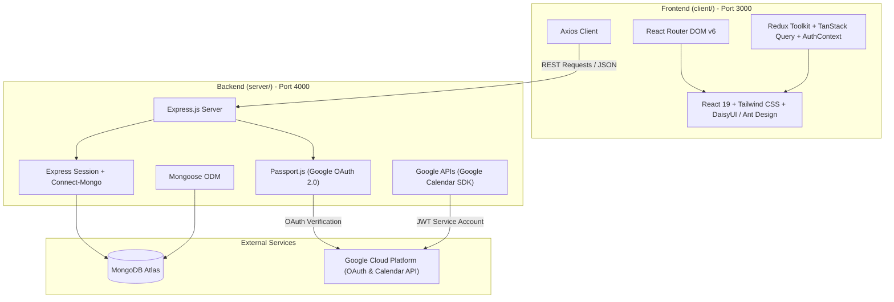

# AIROST Intranet Tech Stack & Package Management

This document provides a comprehensive overview of the technical stack, packages, libraries, architecture, and deployment configurations used in the **AIROST Intranet** project.

---

## 1. High-Level Architecture

The repository is organized as a decoupled monorepo containing a React Single Page Application (SPA) frontend and a Node.js / Express REST API backend.

---

## 2. Frontend Tech Stack (`client/`)

* **Directory:** [`client/`](file:///c:/Users/ganru/Documents/airost-intranet/client)
* **Configuration:** [`client/package.json`](file:///c:/Users/ganru/Documents/airost-intranet/client/package.json)
* **Port (Dev):** `3000` (proxied to `http://localhost:4000/`)

### Core & Framework
| Package | Version | Description |
| :--- | :--- | :--- |
| **React** | `^19.1.0` | Core UI library for component-based architecture. |
| **React DOM** | `^19.1.0` | React rendering engine for the web DOM. |
| **react-scripts** | `^5.0.1` | Create React App build pipeline, Webpack bundler, and Babel configuration. |

### Routing & Navigation
| Package | Version | Description |
| :--- | :--- | :--- |
| **react-router-dom** | `^6.10.0` | Declarative routing, route protection (`RequireAuth`), and navigation. |

### State Management & Data Fetching
| Package | Version | Description |
| :--- | :--- | :--- |
| **@reduxjs/toolkit** | `^2.6.1` | Modern Redux store for global complex state (e.g., Project Tracking boards). |
| **react-redux** | `^9.2.0` | React bindings for Redux. |
| **@tanstack/react-query** | `^5.32.0` | Server-state synchronization, caching, and mutation management. |
| **React Context API** | Native | Application-wide authentication state provider (`AuthProvider`). |

### UI, Styling & Design Systems
| Package | Version | Description |
| :--- | :--- | :--- |
| **tailwindcss** | `^3.4.3` | Utility-first CSS framework. |
| **daisyui** | `^4.10.2` | Tailwind CSS component library providing pre-styled utility components and themes. |
| **antd** | `^5.18.0` | Ant Design component system (used for Modals, inputs, and enterprise components). |
| **mdb-react-ui-kit** | `^6.0.0` | Material Design for Bootstrap React UI kit. |
| **framer-motion** | `^11.1.7` | Production-ready motion and gesture library for animations. |
| **react-icons** | `^4.12.0` | Unified icon library (Bootstrap Icons, FontAwesome, etc.). |

### Forms, Rich Text & Utilities
| Package | Version | Description |
| :--- | :--- | :--- |
| **axios** | `^1.5.1` | Promise-based HTTP client for REST API communication. |
| **react-hook-form** | `^7.51.4` | Performant form state management and validation. |
| **react-select** | `^5.7.7` | Flexible select and autocomplete input controls. |
| **react-quill** | `^2.0.0` | Rich text WYSIWYG editor for documentation creation. |
| **react-tailwindcss-datepicker** | `^1.6.6` | Date range picker designed for Tailwind CSS. |
| **date-fns** | `^3.1.0` | Lightweight modern JavaScript date utility library. |
| **moment** | `^2.30.1` | Legacy JavaScript date/time parser and formatter. |
| **lodash** | `^4.17.21` | Utility functions for array/object manipulation and debouncing. |
| **uuid** | `^11.1.0` | RFC-compliant UUID generator for unique IDs. |

---

## 3. Backend Tech Stack (`server/`)

* **Directory:** [`server/`](file:///c:/Users/ganru/Documents/airost-intranet/server)
* **Configuration:** [`server/package.json`](file:///c:/Users/ganru/Documents/airost-intranet/server/package.json)
* **Port (Dev):** `4000` (configured via `.env` or defaulting to `4000`)

### Runtime, Server & Routing
| Package | Version | Description |
| :--- | :--- | :--- |
| **Node.js** | `>=18.0.0` | JavaScript runtime (Docker uses Node 18; local env runs Node 24). |
| **express** | `^4.18.2` | Fast, unopinionated minimalist web framework for REST API endpoints. |
| **cors** | `^2.8.5` | Cross-Origin Resource Sharing middleware for client-server communication. |
| **dotenv** | `^16.3.1` | Environment variable loader from `.env` file. |
| **nodemon** | `^3.0.1` | Development utility to automatically monitor file changes and restart the process. |

### Database & ODM
| Package | Version | Description |
| :--- | :--- | :--- |
| **MongoDB Atlas** | Cloud | Managed cloud NoSQL database cluster. |
| **mongoose** | `^6.10.0` | Object Data Modeling (ODM) library for MongoDB validation, models, and queries. |
| **mongodb** | `^5.7.0` | Official MongoDB native driver for Node.js. |

### Authentication & Sessions
| Package | Version | Description |
| :--- | :--- | :--- |
| **passport** | `^0.5.3` | Authentication middleware for Node.js. |
| **passport-google-oauth20** | `^2.0.0` | Passport strategy for authenticating with Google OAuth 2.0. |
| **express-session** | `^1.17.3` | Session middleware for Express. |
| **connect-mongo** | `^5.0.0` | MongoDB-backed session storage for Express sessions. |
| **cookie-session** | `^2.1.0` | Cookie-based session handling utility. |

### Cloud Integrations & External Services
| Package | Version | Description |
| :--- | :--- | :--- |
| **googleapis** | `^130.0.0` | Official Google APIs client library (used for Google Calendar synchronization). |

---

## 4. Package Management & Deployment

### Monorepo Setup
The project functions as an **independent two-tier repository** without monorepo tooling (no npm workspaces, Lerna, or Turborepo).
* Each package (`client/` and `server/`) maintains its own `package.json` and `package-lock.json`.
* Both directories require separate `npm install` runs before starting development.

### Development Scripts

#### Backend (`server/`)
* **`npm run dev`**: Starts the server using `nodemon` with `NODE_ENV=development`.
* **`npm start`**: Runs `node server.js` directly.

#### Frontend (`client/`)
* **`npm start`**: Starts React development server on port 3000 (`set PORT=3000 && react-scripts start`).
* **`npm run build`**: Compiles production static assets via Webpack.
* **`npm test`**: Runs unit and integration test suites using Jest and React Testing Library.

### Containerization & Deployment
* **Dockerfile:** Located at [`server/Dockerfile`](file:///c:/Users/ganru/Documents/airost-intranet/server/Dockerfile).
* **Target Environment:** Google Cloud Run.
* **Base Image:** `node:18`.
* **Production Port:** `8080`.

---

## 5. Technical Review & Recommendations

1. **Misplaced Server Dependencies:**
   * `@tanstack/react-query` is listed in [`server/package.json`](file:///c:/Users/ganru/Documents/airost-intranet/server/package.json#L14). This is a frontend library and should be removed from the server dependencies.
   * `git-filter-repo` is listed in [`server/package.json`](file:///c:/Users/ganru/Documents/airost-intranet/server/package.json#L21) and is not needed as a runtime dependency.

2. **Frontend UI Library Duplication:**
   * The client combines **three** distinct UI frameworks: **Tailwind CSS + DaisyUI**, **Ant Design**, and **MDB React UI Kit**.
   * *Recommendation:* Standardizing on Tailwind CSS + DaisyUI (or Ant Design alone) will significantly reduce the JavaScript bundle size and prevent style collisions.

3. **Date Library Redundancy:**
   * Both `date-fns` and `moment` are installed. `moment` is deprecated/in maintenance mode; migrating all moment calls to `date-fns` will reduce bundle overhead.

4. **Node.js Version Alignment:**
   * Local development uses Node.js v24, whereas the production container targets Node.js 18. Aligning local engines or upgrading the Dockerfile to an updated LTS (such as Node 20 LTS or Node 22 LTS) ensures consistency across environments.
